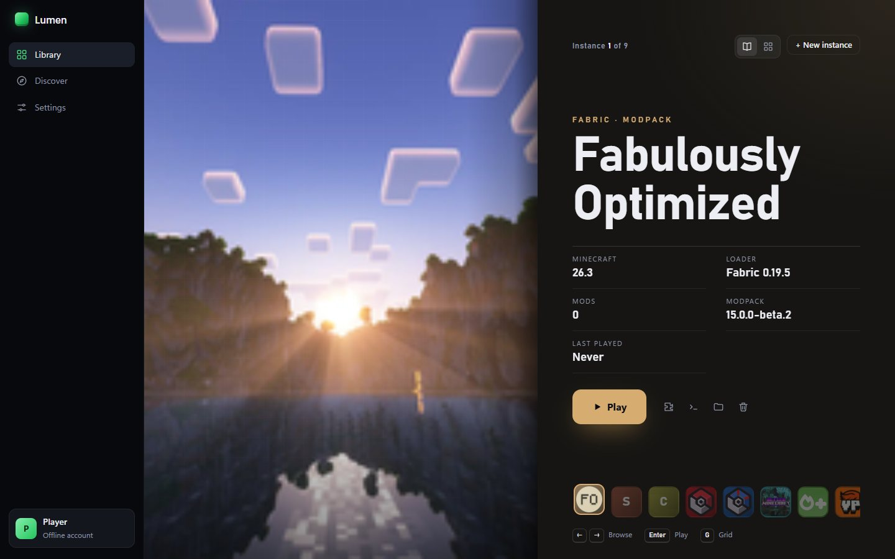

<p align="center"></p>

<h1 align="center">Lumen</h1>

<p align="center">A Minecraft: Java Edition launcher for Windows that shows your instances like an art book.<br>
<a href="https://lumenlauncher.app">lumenlauncher.app</a> · English &amp; Deutsch</p>

<p align="center"></p>

## Download

Get the latest **installer** or **ZIP** (no installation) from [Releases](https://github.com/bluexoak/lumen-launcher/releases/latest) or [lumenlauncher.app](https://lumenlauncher.app). Windows 10/11, 64-bit.

The builds aren't code-signed yet: if SmartScreen says *"Windows protected your PC"*, click **More info → Run anyway**. Each release lists SHA-256 checksums.

## Features

- **Instances** for any Minecraft version – vanilla, Fabric, Quilt, Forge (1.13+) or NeoForge – each with its own worlds, mods, memory, Java arguments, cover image and playtime
- **Modpacks** from Modrinth in one click (`.mrpack`, every file checksum-verified)
- **Content browser per instance** for mods, resource packs and shader packs (Iris/Oculus installed along), with automatic dependencies and one-click updates (stable releases only)
- **Move over** from the official launcher, Prism/PolyMC, CurseForge, ATLauncher or the Modrinth App: worlds, mods, packs and settings are copied
- **Share** an instance as a `.mrpack`, import `.mrpack` files, duplicate instances
- **Updates itself** (installer version)
- **Java handled for you**: an installed JDK/JRE of the right version is used, otherwise Eclipse Temurin is downloaded and verified
- **Five layouts** – Art Book, Carousel, List, Shelf, Terminal – and **five colour schemes**, freely combinable
- **Controller support**: d-pad to browse, A to play, B to go back, Y to switch views
- **Offline play** with a player name, or **Microsoft sign-in** (see below)
- **English and German** UI, following the system language by default

Not supported: Forge before Minecraft 1.13, CurseForge-only modpacks.

## Run from source

Requires [Node.js](https://nodejs.org) 20 or newer, on Windows 10/11 (64-bit).

```bash
npm install
npm start
```

Build the installer and a portable `.exe` into `dist/`:

```bash
npm run dist
```

Self-checks: `npm test` (launcher logic), `node auth.js` (Microsoft sign-in flow against a fake backend), `node i18n.js` (both languages have the same strings).

## Microsoft sign-in

Lumen uses the device-code flow with its own Azure app (public client, no secret; the client ID lives in `auth.js`). The app is approved for the Minecraft API, so signing in and playing online works out of the box.

Building your own fork? Register your own app in the [Microsoft Entra admin center](https://entra.microsoft.com) (account type **Personal Microsoft accounts only**, **Allow public client flows** on), apply for Minecraft API access (`aka.ms/mce-reviewappid`) and put its *Application (client) ID* into `CLIENT_ID` in `auth.js`.

Tokens are stored encrypted with Windows DPAPI (`%APPDATA%\.lumen\account.bin`).

## Data

Everything Lumen downloads or creates lives in `%APPDATA%\.lumen` (instances, shared libraries and assets, Java runtimes, settings). Uninstalling Lumen leaves it in place.

Lumen talks to Mojang/Microsoft (game files, sign-in), Modrinth (modpacks, mods, icons), Fabric/Quilt/Forge/NeoForge (loader metadata and installers), Adoptium (Java) and GitHub (update check). It has no analytics or tracking.

## Project layout

| Path | What it is |
|---|---|
| `main.js`, `preload.js` | Electron main process and the IPC bridge (channel allow-list) |
| `launcher.js` | versions, downloads, Java, launching, instances, Modrinth |
| `auth.js` | Microsoft → Xbox Live → Minecraft sign-in |
| `i18n.js` | all UI strings, German and English |
| `app.js`, `layouts.js`, `index.html`, `style.css` | the interface |
| `site/` | the website, a Cloudflare Worker with static assets |

## License

[GPL-3.0](LICENSE). Not an official Minecraft product. Not approved by or associated with Mojang or Microsoft.
